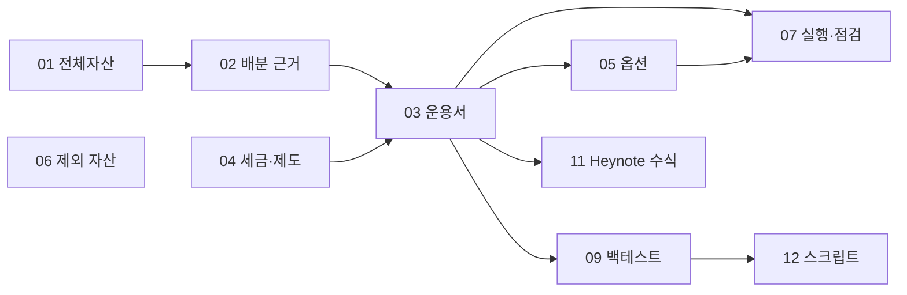

# fin.portfolio — 포트폴리오 설계 인덱스

> 단일 통합본 `fin.portfolio.md`를 대체한다. 이 문서는 입구다. 내용은 아래 10개 문서에 있다.
>
> 전제: 43세, 직장 재직 중(총급여 5,500만원 초과 → 연금 세액공제율 13.2%), **적립기**(인출 없음), 현금흐름 불필요, 투자기간 10년 이상 / 30년 지향, 채권 제외
> 부동산: **수도권 실거주 1주택 (확정)**. 총자산 부동산 8 : 유동자산 5 (약 61.5% / 38.5%)
> 인출 개시는 근로소득이 끝난 뒤로 미룬다
> 계좌: 달러 계좌, 절세 계좌(연금저축·IRP·ISA), 국내 일반 계좌, 금현물계좌
> 절세 계좌 여력: 연금저축·IRP 합산 1,800만원 + ISA 2,000만원 = 연 3,800만원
> 월 납입금: 약 330만원 (연 약 3,960만원)
> 현재 규모·계좌별 금액: [[R-1\|fin.portfolio.03-rebalancing#r-1-계좌-배치]]에서만 관리 (**최신 평가액 재측정 필요 — [[E-1\|fin.portfolio.07-execution#e-1-이행--무엇을-언제-옮기나]] 0단계**)
> 원자료(기준 문서·인수인계 문서 등)와 유의사항: [[5. 원자료와 유의사항|#5-원자료와-유의사항]]. 투자 자문이 아니다.

## 1. 기준안 배분 (요약)

| 성장주 (나스닥100 + VGT, 선택 시 모멘텀) | SCHD 대응 | KRX 금현물 | 현금 (IRP 안전자산 포함) | 주식 노출 |
| ---------------------------------------- | --------- | ---------- | ------------------------ | --------- |
| **55%**                                  | **20%**   | **15%**    | **10%**                  | **75%**   |

- 원본은 [[A-1|fin.portfolio.02-allocation#a-1-기준안]] — 비중을 바꿀 때는 A-1을 고치고 이 표를 맞춘다.
- 밴드: 상대 ±20% 발동, ±10% 복귀 → [[R-4.1|fin.portfolio.03-rebalancing#r-41-밴드--상대-20-tolerance-10]]
- 이 배분에 대한 20년 백테스트 검증: [[B|fin.portfolio.09-backtest]]

## 2. 문서 지도

| 문서                                                           | 접두어 | 담는 내용                                                                                    | 여는 때                                    |
| -------------------------------------------------------------- | ------ | -------------------------------------------------------------------------------------------- | ------------------------------------------ |
| [[01 전체자산 구조\|fin.portfolio.01-net-worth]]               | **N**  | 부동산·대출·비상금, 순자산 관점의 제약                                                       | 대출·시세 확정, 주거 관련 결정             |
| [[02 배분 근거\|fin.portfolio.02-allocation]]                  | **A**  | 기준안 배분, SCHD·금 비중 근거, 금현물 선택, 환노출, 메가캡 리스크, 지수 선택                | 비중 자체를 재검토할 때                    |
| [[03 계좌 배치·리밸런싱 운용서\|fin.portfolio.03-rebalancing]] | **R**  | 계좌별 배치 금액·기준 비율, 계좌 운용 규칙, IRP 70%, 매도 우선순위, 밴드·납입금 규칙         | **매월 납입일, 밴드 이탈 시**              |
| [[04 세금·계좌 제도\|fin.portfolio.04-tax]]                    | **T**  | 세 경로 세율, 해외 배당 원천징수, 연간 세금 관리, 연금 인출 병목, 연금 900만·ISA 비이전 근거 | 세법·소득 구간이 바뀔 때, 11~12월          |
| [[05 선택 옵션\|fin.portfolio.05-options]]                     | **O**  | KIWOOM 모멘텀 ETF, 개별주 모멘텀 슬리브                                                      | 옵션 채택 판단, 3·9월 지수 리밸런싱 후     |
| [[06 검토 후 제외한 자산\|fin.portfolio.06-excluded]]          | **X**  | 검토 후 제외한 자산과 사유                                                                   | 새 자산 편입 아이디어가 생겼을 때          |
| [[07 실행·점검\|fin.portfolio.07-execution]]                   | **E**  | 이행 단계, 재검토 트리거, 미해결 사항, 연 1회 점검                                           | 할 일 확인, 연 1회 점검                    |
| [[09 백테스트\|fin.portfolio.09-backtest]]                     | **B**  | 기준안·공격적안·SCHD 축소안·전환 규칙 20년 시뮬레이션 결과, 방법론과 한계                    | 배분·밴드 규칙을 바꾼 뒤 검증하고 싶을 때  |
| [[11 Heynote 리밸런싱 수식\|fin.portfolio.11-heynote]]         | **HN** | R-4 규칙을 heynote math 모드로 구현한 월간 점검용 수식                                       | **매월 납입일, 밴드 이탈 여부 계산할 때**  |
| [[12 시뮬레이션 스크립트\|fin.portfolio.12-scripts]]           | **S**  | 09의 수치를 재생성하는 파이썬 스크립트 (B-11 재현)                                           | 백테스트를 다시 돌리거나 배분을 바꿔 볼 때 |

**읽는 순서.** 처음이면 00 → 01 → 02 → 03. 평소에는 03과 07(계산은 11).

## 3. 분할 기준

**3.1 여는 빈도와 바뀌는 이유로 나눈다.** 규칙(03)은 매월 열고, 근거(02·04)는 전제가 바뀔 때만 연다. 같은 주제라도 "무엇을 하는가"와 "왜 그런가"를 다른 문서에 둔다.

- 03에는 규칙과 결론 한 줄만 두고, 계산은 04로 링크한다. 예: 연금 900만원 한도의 결론은 R-2.7, 계산은 T-5.
- 매도 우선순위(R-3)는 규칙이므로 03, 그 근거인 세율 표(T-1)는 제도이므로 04. 세율이 바뀌면 04를 고치고 R-3의 순서가 뒤집히는지만 확인한다.

**3.2 서로를 계속 참조하는 규칙은 한 문서에 묶는다.** 계좌별 비중(R-1)·계좌 운용 원칙(R-2)·매도 순서(R-3)·밴드와 납입금 규칙(R-4)은 하나를 바꾸면 나머지를 함께 봐야 하므로 03에 모은다.

**3.3 일회성 내용과 상시 규칙을 섞지 않는다.** 재편 이행 단계(E-1)는 끝나면 사라질 내용이라 07에 둔다. 이행이 끝나면 삭제한다 — 기록은 git 이력에 남는다.

**3.4 채택 미정인 전략은 따로 둔다.** 모멘텀 ETF와 개별주 모멘텀(05)은 채택 여부가 열려 있어 코어 규칙과 분리한다. 두 전략은 한 문서에 있지만 예산을 공유하지 않는다.

**3.5 참고 기록은 링크로 대체한다.** 제외 자산(06)은 운용 판단에 쓰이지 않으므로 본문에서 빼고 링크로만 참조한다.

**3.6 변하는 숫자는 한 곳에서만 관리한다.**

| 숫자                                          | 원본                                       |
| --------------------------------------------- | ------------------------------------------ |
| 기준안 배분 비중                              | A-1 (이 문서 1장은 요약)                   |
| 평가액, 계좌별 금액·기준 비율, 연 납입금 배분 | R-1                                        |
| 밴드 폭                                       | R-4.1                                      |
| 세율·한도                                     | T-1, T-4                                   |
| 모멘텀 옵션 상한                              | O-1 (연금 성장주 금액은 R-1을 따름)        |
| 백테스트 결과 수치 (XIRR·MDD)                 | B-3, B-4, B-7, B-10 (A-4·A-4.1·O-3은 인용) |

다른 문서에 같은 숫자가 나오면 설명용 인용이며, 불일치 시 원본이 우선한다.

**3.7 수정 파급 방향.** 링크는 탐색용이라 양방향으로 걸려 있지만, **내용을 고쳤을 때 확인할 문서**는 한 방향으로 정해 둔다.

- 04를 고치면 → 03 → 07 순으로 확인
- 02를 고치면 → 03 → 05 → 07
- 03을 고치면 → 05·07
- 02·03을 고치면 → 09에서 재검증 여부 확인 (자동 반영되지 않음, 수동 재실행 필요)
- 06은 다른 문서의 판단에 영향을 주지 않는다
- 09도 마찬가지로 다른 문서의 판단에 영향을 주지 않는다 — 검증 기록이며 결론의 근거가 아니다.
- 12는 09의 부속이다 — 결론은 담지 않고 09의 수치를 재생성하는 코드만 둔다
- 11도 마찬가지로 다른 문서의 판단에 영향을 주지 않는다 — 03의 규칙을 계산기로 옮긴 것일 뿐, 03을 고치면 11의 상수(HN-3)를 맞춰야 하는 것은 반대 방향이다.

**3.8 문서를 추가하거나 합칠 때.** 위 기준으로 어느 문서에 속하는지 먼저 정하고, 새 문서가 필요하면 `fin.portfolio.NN-이름.md`로 만들고 새 접두어를 이 표에 추가한다. 01과 04의 병합 여부는 실제 사용 후 결정한다(미정).

**3.9 변경 이력은 문서로 두지 않는다 (2026-10-15).** 문서는 git으로 관리한다.

- **무엇이 바뀌었는지는 diff가, 왜 바꿨는지는 커밋 메시지 본문이 맡는다.** 발단, 결정, 검토했으나 택하지 않은 대안을 커밋 메시지에 쓴다.
- **앞으로도 유효한 판단 근거는 해당 주제 문서의 절에 둔다.** 특히 채택하지 않은 제안과 그 이유는 diff에 흔적이 남지 않으므로 반드시 주제 문서에 남긴다(예: R-4.3·R-4.8·R-4.14, T-5·T-6, O-1, 06).
- **개정 사유는 해당 절 첫머리의 날짜 박스로 짧게 남긴다**(예: A-3 "2026-10-13 개정").
- git 밖에서 문서만 읽는 쪽(Claude 등)은 커밋 로그를 보지 못한다. "왜"가 커밋 메시지에만 있으면 그 판단은 다음 세션에서 사라진다고 본다.
- 08 변경 이력 문서는 이 원칙에 따라 폐지했다. 그 안의 원자료 설명과 유의사항은 5장으로, 참고 문헌은 R-6과 O-1로 옮겼다.

## 4. 번호·링크 규칙

- **번호**: 문서별 접두어 + 번호. `R-4.1` = 03 문서 R-4의 1절. 헤딩은 `## R-4 …`, `### R-4.1 …` 형태로 번호로 시작한다.
- **링크**: dendron 위키링크 `[[번호|파일#슬러그]]`. 같은 문서 안은 `[[번호|#슬러그]]`. 슬러그는 헤딩 텍스트를 소문자화하고, 단어문자·공백·하이픈 외의 문자(구두점 등)는 삭제하고, 남은 공백을 하나씩 하이픈으로 바꾼 것이다 — 여러 문자가 삭제돼 공백이 연달아 남으면 하이픈도 그만큼 연달아 나온다 (예: `A-7 메가캡 고평가 문제 — SCHD의 존재 이유` → `a-7-메가캡-고평가-문제--schd의-존재-이유`, `—` 앞뒤 공백 2개가 하이픈 2개로 남는다).
- **표 안의 링크**는 레이블(번호)과 대상 사이 구분자를 `\|`로 쓴다.
- **헤딩에는** `:` `#` `|` `^` `[` `]`를 쓰지 않고, 링크도 넣지 않는다. 헤딩을 바꾸면 그 헤딩을 가리키는 링크를 함께 고친다(Obsidian의 헤딩 이름 변경 시 링크 자동 갱신 기능을 켜 두면 편하다).
- **외부 문서의 절 번호**(예: "인수인계 문서 §3-2")는 원문 번호이므로 `§` 표기를 그대로 둔다. 이 설계 문서 안에서는 `§`를 쓰지 않는다.

## 5. 원자료와 유의사항

### 5.1 원자료

이 설계는 아래 네 자료를 합쳐 만들었다. 본문은 이 이름으로 인용한다.

| 자료                                            | 내용                                                                                              | 이 설계에 들어간 곳                                                                                                                                |
| ----------------------------------------------- | ------------------------------------------------------------------------------------------------- | -------------------------------------------------------------------------------------------------------------------------------------------------- |
| **기준 문서**                                   | 유동자산만 다룬 최초 설계 — 밴드·계좌·세금 체계                                                   | 03·04의 골격                                                                                                                                       |
| **인수인계 문서**                               | 부동산·대출을 포함한 전체자산 관점의 검토. 본문의 "인수인계 문서 §x-y"는 이 문서의 원문 절 번호다 | 01 전체, SCHD 30→25%·금 10→15% 변경의 출발점                                                                                                       |
| **모멘텀 검토 자료** (2026-09-15)               | KIWOOM 미국S&P500모멘텀·SPMO 편입 검토. SPMO 성과·낙폭, QQQ–SPMO·SPMO–SCHD·연도별 QQQ–SCHD 상관   | [[O-1\|fin.portfolio.05-options#o-1-모멘텀-팩터-etf--kiwoom-미국sp500모멘텀]], A-7.2, A-8                                                          |
| **IRP 한도·계좌별 목표 비율 검토** (2026-09-16) | IRP 위험자산 70% 한도 반영, 계좌별 목표 비율과 운용 규칙 6개 제안                                 | [[R-1\|fin.portfolio.03-rebalancing#r-1-계좌-배치]], R-2.2~R-2.4. 제안 6개의 처리는 [[R-2.3\|fin.portfolio.03-rebalancing#r-23-계좌-운용-규칙]] 표 |

**기준 문서와 인수인계 문서가 같은 대상을 다르게 말한 곳**은 아래처럼 정리했다.

| 항목               | 기준 문서                         | 인수인계 문서           | 채택             | 근거                                                                                                                                          |
| ------------------ | --------------------------------- | ----------------------- | ---------------- | --------------------------------------------------------------------------------------------------------------------------------------------- |
| SCHD 비중          | 30%                               | 축소                    | 25% → 현재 20%   | [[A-2\|fin.portfolio.02-allocation#a-2-schd-30--25]], [[A-4.1\|fin.portfolio.02-allocation#a-41-schd-비중--결정-근거-재정리-2026-09-22-개정]] |
| 금 비중            | 10%                               | 총자산 5~8%             | 15%              | [[A-3\|fin.portfolio.02-allocation#a-3-금-10--15]]                                                                                            |
| 리밸런싱 점검 주기 | 월 1회                            | 분기                    | 월 1회           | [[R-4.8\|fin.portfolio.03-rebalancing#r-48-점검-빈도--월-1회-납입일마다]]                                                                     |
| 달러 계좌 취급     | 매도 우선순위 4위(공제)·7위(초과) | 축에서 제외, buy & hold | 구간별 분리 유지 | [[R-3\|fin.portfolio.03-rebalancing#r-3-매도-우선순위]]                                                                                       |
| IRP 안전자산       | 규칙화 안 함                      | 적극 운용               | 실행 경로 편입   | [[R-2.4\|fin.portfolio.03-rebalancing#r-24-irp-위험자산-70-한도--계좌-단위-하드-제약]]                                                        |
| 부동산 밴드        | 다루지 않음                       | 비대칭 밴드 설계 필요   | 밴드 두지 않음   | [[N-3\|fin.portfolio.01-net-worth#n-3-8-대-5는-목표가-아니라-현재-상태의-기술이다]]                                                           |
| 대출 상환          | 다루지 않음                       | 자본구조 결정으로 분리  | 채택 + 정량화    | [[N-6\|fin.portfolio.01-net-worth#n-6-대출--자본구조-결정이며-리밸런싱-도구가-아니다]]                                                        |

**모멘텀 검토 자료에서 채택하지 않은 제안**은 각 절에 사유와 함께 있다 — 절대 밴드 ±5%p(R-4.3), 분기 점검(R-4.8), 모멘텀 비중 20~30%와 연금계좌 구성안(O-1), 연금소득세 3.3~5.5% 전제(T-5), 달러계좌 SPMO(X-3), 국내 주식형·모멘텀 ETF(X-4), IRP 채권혼합형(R-2.4).

### 5.2 유의사항

- 본 문서는 대화 내용을 정리한 참고자료이며 투자 자문이 아니다
- 수치는 Yahoo Finance, PortfoliosLab, FunETF, 각 운용사 공시 기준이며 데이터 출처·측정 시점에 따라 달라진다
- 상관계수와 베타는 측정 기간에 따라 크게 변동한다. **특히 부동산 관련 상관은 평활화 편향으로 과소추정되어 있다** ([[N-4|fin.portfolio.01-net-worth#n-4-부동산의-분산-효과를-과대평가하지-말-것]]). 연도별 상관은 월 12개 데이터라 오차가 크다
- **KIWOOM 모멘텀의 장기 성과는 SPMO(달러) 대리 데이터다.** 모의 계산은 원화 환산·세금·매매비용 미반영이며, 월말 기준 MDD는 실제 장중 낙폭보다 작다
- [[N-1|fin.portfolio.01-net-worth#n-1-자산-지도]]과 [[N-3|fin.portfolio.01-net-worth#n-3-8-대-5는-목표가-아니라-현재-상태의-기술이다]]의 순자산 계산은 부동산 시세·대출 잔액이 미확정인 상태의 추정치다. 확정 후 재계산 필요 ([[E-3|fin.portfolio.07-execution#e-3-미해결-사항]])
- [[R-1|fin.portfolio.03-rebalancing#r-1-계좌-배치]]의 계좌별 금액은 2026년 9월 기준 평가액(연금저축 8,470만 / IRP 2,280만 / ISA 3,650만)으로 계산한 기준점이며, 재측정 후 갱신한다
- 보유종목·보수·지수 규정은 수시 변경되므로 매수 전 각 운용사 공식 페이지에서 확인이 필요하다
- **세제·건보료·퇴직연금·중도상환수수료 규정은 변경이 잦고 개인 상황에 따라 다르다.** 실행 전 금융기관·세무 전문가 확인을 권장한다
- 과거 수익률은 미래를 보장하지 않는다

### 5.3 참고 문헌 위치

| 주제                                 | 위치                                                                                                  |
| ------------------------------------ | ----------------------------------------------------------------------------------------------------- |
| 리밸런싱 밴드·halfway-back·점검 빈도 | [[R-6\|fin.portfolio.03-rebalancing#r-6-참고-문헌]]                                                   |
| 모멘텀 상품·데이터                   | [[O-1\|fin.portfolio.05-options#o-1-모멘텀-팩터-etf--kiwoom-미국sp500모멘텀]] 끝 "출처"               |
| 금·인플레이션 국면·주식–채권 상관    | [[A-3.6\|fin.portfolio.02-allocation#a-36-참고-문헌]]                                                 |
| 금현물 거래비용·요율                 | [[B-13\|fin.portfolio.09-backtest#b-13-회전율거래비용--배분-판단의-변수가-아니다-2026-09-22]] 끝 출처 |
| 백테스트 가격 데이터·실행 기록       | [[B-12\|fin.portfolio.09-backtest#b-12-출처]]                                                         |
